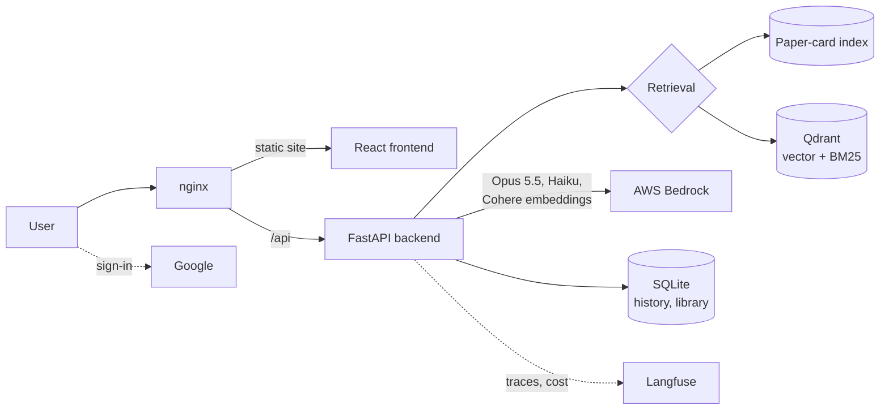

# Research RAG Assistant: Evidence-Grounded Q&A over 441 Research Papers (Case Study)

A retrieval-augmented generation (RAG) assistant that lets planners, policymakers and investors ask questions in plain language and get **cited, evidence-grounded answers** from a curated library of 441 wildfire-adaptation and public-health research papers. Each answer comes with a confidence score based on how strongly the retrieved evidence supports it.

> **About this repo:** the production system was built for a research center and its code is private. This case study covers the problem, architecture, evaluation and key decisions. It contains no source code, data or organization-specific details.

| Item | Details |
|---|---|
| **My role** | Technical lead |
| **Stack** | React · Vite · Tailwind/shadcn · FastAPI · Qdrant · SQLite · AWS Bedrock (Claude Opus 5.5, Claude Haiku, Cohere Embed v4) · nginx · EC2 · Google Sign-In · Langfuse |
| **Corpus** | 441 papers · 24,429 text chunks |
| **Status** | In production (2026) |

## My Role

- Set the technical direction and coordinated development across major releases.
- Managed the AWS environment: service and model settings, the EC2 server, and IP and network configuration.
- Turned researcher and stakeholder needs into product requirements: cited answers, confidence scoring, follow-up questions, library management, and PDF attachments in chat.
- Oversaw the retrieval evaluation program: the gold-standard benchmark, the experiment plan, and go/no-go criteria for shipping changes.
- Led the review of an externally developed retrieval method: we replicated it on our own stack, corrected its reported numbers, and decided what to adopt.
- Managed releases and go-live, including the rollback plan and production verification.

## The Problem

Research on climate risk is spread across hundreds of papers in many disciplines. The people who make decisions (planners, policymakers, investors) rarely have time to read them, and a general-purpose chatbot can't show where its claims come from. The assistant needed to:
- **answer only from the curated library**, and say so when the library doesn't cover a question;
- **cite the specific papers and pages** behind each claim;
- **show how well-supported** each answer is; and
- let the research team **add and manage papers** without engineering help.

## Architecture

1. **Question in:** the user asks a question. For follow-ups ("what about children?"), Claude Haiku first rewrites the question into a standalone search query. Only retrieval uses the rewrite; the answer model still sees the full conversation.
2. **Retrieval:** papers are ranked by a "card" (title + abstract) and their best passage, matched against the question and against a hypothetical answer drafted by Claude Haiku (HyDE). The top 20 papers, with one passage each, go to the answer model.
3. **Answer:** Claude Opus 5.5 writes a structured answer (direct answer, key takeaways, evidence summary, stakeholder notes) citing only the retrieved papers, plus a **retrieval-based confidence score**.
4. **Deployment:** the frontend and API are served from the same origin behind nginx on EC2. The API listens only on localhost, and AWS access uses an IAM role, so no API keys are stored.

## Key Features

| Feature | Details |
|---|---|
| Cited answers | Every claim links to the paper and page; off-topic questions get a clear "not covered" response with no citations |
| Confidence score | Computed from the relevance of the cited evidence, not from the model rating itself |
| Follow-up questions | History-aware query rewriting, so referential questions still retrieve the right evidence |
| Accounts | Google Sign-In; conversations saved per user |
| Library management | Approved researchers upload, edit, soft-delete and restore papers; a new paper is searchable and citable in about 10 seconds |
| Chat attachments | Users can attach a PDF to one conversation only; it never enters the shared library, and size, page and retention limits apply |
| Observability | Token usage and cost per model, user and session (Langfuse) |
| Mobile support | Responsive chat and content pages |

## Evaluation

Retrieval changes were shipped only with measured evidence.

**Benchmark:** 21 questions with expert reference answers; the "gold" papers for each question are the ones the reference answers cite (139 question–paper links). Key metrics:
- **Context recall:** the share of gold papers that actually reach the answer model.
- **Cited gold recall:** the share of gold papers the final answer cites.
- **Blind pairwise judging:** an LLM judge compares two answers in both orders, and a win requires both orders to agree.

Differences are reported with paired-bootstrap 95% confidence intervals; with 21 questions, differences of about ±3 points are noise.

### Result of the change that went live

| Metric | Before (hybrid chunk retrieval) | After (paper cards + HyDE) |
|---|---|---|
| Context recall | 25.0% | **65.2%** (+40.1 pts, 95% CI +31 to +49; 19 questions better, 0 worse) |
| Gold papers in the top 20 ranked | 53.3% | **65.2%** |
| Gold papers cited by the answer | 21.7% | **45.6%** (+23.9 pts, 95% CI +15.8 to +31.6) |
| Blind judge (21 questions) | 1 win | **18 wins** (2 split) |
| Retrieval time (median) | 9.5 s | **4.0 s** |
| End-to-end time (median) | 29.8 s | 28.7 s |
| Share of cited papers that are gold | 27.3% | 26.1% (unchanged) |

### What the experiments showed

More than 20 documented experiments over five weeks narrowed down why recall was low:
- **The implementation wasn't the problem.** An audit confirmed the similarity and keyword scoring were numerically correct (error below 1e-15).
- **Bigger candidate pools didn't help.** Doubling or quadrupling the pool raised candidate recall to 89%, but the extra papers landed at the bottom of the ranking and final recall didn't change.
- **Common fixes failed:**
  - Stemming hurt keyword search (27.7% → 20.4%).
  - Several published techniques gave no reliable gain: LLM reranking, Doc2Query, Contextual Retrieval, scientific-paper embeddings, and a commercial reranker.
- **The real causes:** boilerplate passages dominated the ranking, and too few *distinct papers* reached the model (8 chunks covered only about 6 papers).
- **Context size was the biggest lever.** Giving the model 8 / 12 / 16 / 20 / 30 papers produced recall of 41.5 / 51.5 / 57.1 / 65.0 / 73.4%. We chose 20 to balance recall, cost and answer length.

### Replicating an external method before adopting it

The paper-card method came from an outside team and had only been measured on a different cloud stack. Before adopting it, we:
- re-ran it on our stack, with our embedding model and baselines;
- found that its headline recall (50.4%) depended on a different embedding model (40.8% on ours), and that its "before" number overstated what production actually served (30.8% vs. 25.0%);
- re-tested its rejected alternatives (about a dozen); all but one failed on our stack too;
- confirmed that the code changed nothing when switched off (all 441 papers chunked byte-for-byte identically, 30 of 30 tests passed); and
- recalibrated the confidence score, raised the server's upload size limit, and tested the upload path, before go-live.

## Key Decisions

- **Rank papers, not chunks.** Decision-makers need breadth of evidence. Ranking papers first, then serving one passage each, more than doubled the evidence reaching the model at the same end-to-end speed.
- **Confidence from evidence, not self-report.** The score reflects how strongly the retrieved passages support the answer, so it can't be inflated by a confident-sounding model.
- **Measure before shipping.** A fixed benchmark, confidence intervals and an explicit adoption rule kept the team from shipping changes that only looked better.
- **Zero-downtime switching.** Two backends ran side by side during the transition, and nginx could switch between them without changing the public URL or rebuilding anything.
- **Safe-by-default features.** Uploads are disabled unless an allowlist is configured; chat attachments are limited to one conversation and expire automatically.

## Limitations

- **Gold labels are incomplete.** A judge rated about half of the non-gold top results as relevant, so recall figures understate real quality.
- **No held-out question set.** Methods were chosen and evaluated on the same 21 questions.
- **Citation precision didn't improve** (27.3% vs. 26.1%). Answers now cite twice as many papers and are about 20% longer, which may also favor them with the judge.
- **Missing abstracts:** 135 of 441 papers have no detectable abstract, so their cards fall back to the first page's text.
- **Uploads are pilot-scale:** each upload rewrites the full index.
